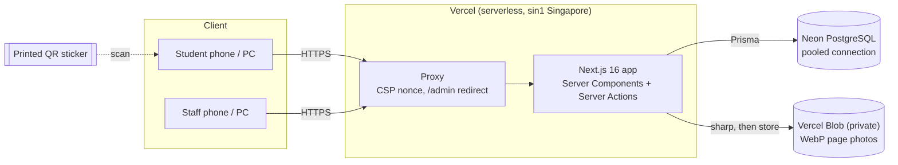
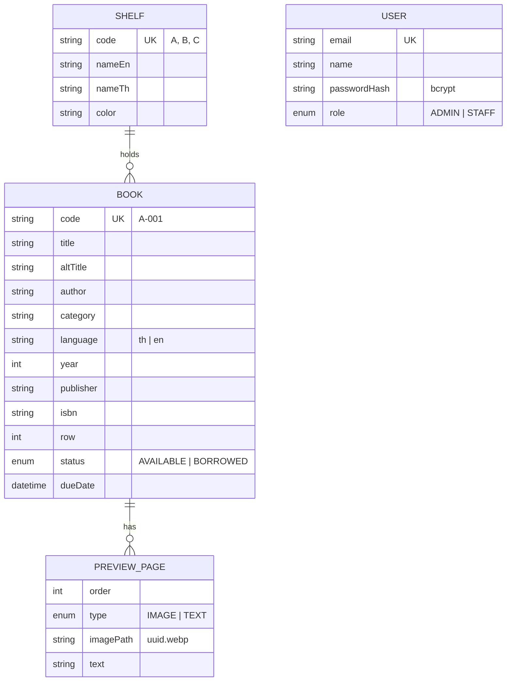
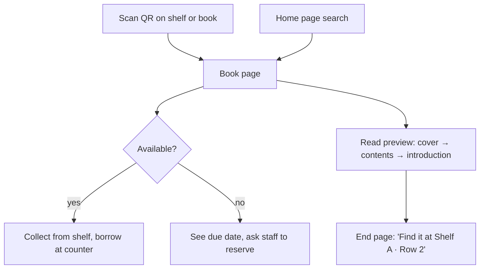
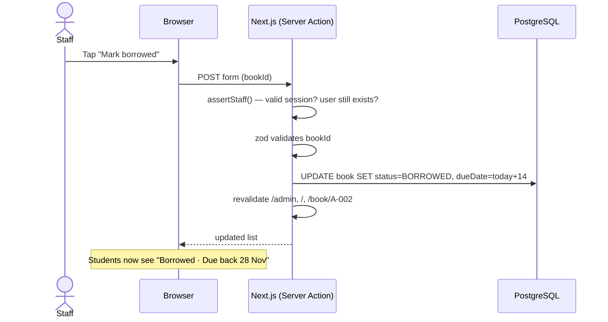
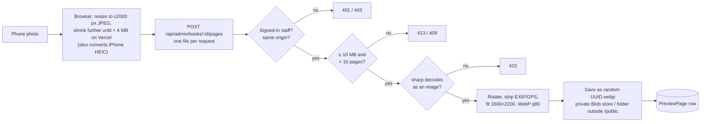

# Siam University Library Book Preview System

**Project report**

| | |
|---|---|
| Student | Sudasun |
| Programme | B.Sc. Information Technology |
| University | Siam University |
| Date | November 2026 |

---

## Abstract

Students often cannot tell whether a library book suits them until they find it on the
shelf, and they cannot tell whether it is on the shelf until they walk to it. This project
builds a bilingual (Thai/English) web application, **Book Preview**, for Siam University
Library. Students browse the catalogue, read a short preview of each book (cover, table of
contents and introduction), see whether the copy is available and exactly where it is
shelved, and then borrow it in person. Every book and shelf carries a printed QR code that
opens its page on a phone. Library staff sign in to add books, photograph preview pages
with a phone camera, and mark books borrowed or returned in one click.

The system is built with Next.js 16, TypeScript, PostgreSQL and Prisma, uses Auth.js for
staff login, and runs online on **Vercel** with a Neon PostgreSQL database and private
Vercel Blob photo storage (https://siam-library.vercel.app); a Docker setup remains for a
university server. Security controls
include server-side role checks, input validation with zod, login rate limiting, a
nonce-based Content Security Policy and verified image uploads. Fifty-six automated
end-to-end tests on desktop and mobile browsers cover search, reading, page turning,
staff login and adding books; 53 pass and 3 are skipped by design, both locally and
against the live site.

## 1. Introduction

University libraries hold many books that students never open because they cannot judge
them from a title alone. Online bookshops solve this with "look inside" previews, but most
library catalogues only show bibliographic data. At the same time, students increasingly
arrive with a phone in hand: a QR code on a shelf is the fastest way to bring the physical
and digital catalogue together.

Book Preview is a small, focused system that fills this gap for Siam University Library.
It does not replace the library's circulation system; it adds a reading preview, live
availability and a precise shelf location, and it gives staff a very simple tool to keep
that information current.

## 2. Objectives

1. Let students **search** the collection by title, author, ISBN or words inside the
   preview, in Thai or English.
2. Let students **read a 5–10 page preview** in a book-like viewer that works well on a
   phone (swipe, large buttons) and on a computer (arrow keys, thumbnails).
3. Show **availability** (available / borrowed with due date) and **location**
   ("Shelf A · Row 2") so students know whether and where to collect the book.
4. Give each book and shelf a **QR code**, with a printable sticker sheet.
5. Let **staff** add and edit books, upload page photos from a phone, and mark books
   borrowed or returned with one click.
6. Apply sound **security practice** suitable for a public university website.
7. Make the system **easy to deploy** on a university server and easy for staff to use.

## 3. Scope

**In scope**
- Public pages: home (search, filters, shelves), book page with preview viewer, shelf page.
- Staff area: login, books list, borrow/return toggle, add/edit/delete book, photo upload
  (max 10 pages, 10 MB each), reordering, QR sticker sheet.
- Thai and English interface with a language toggle (Thai default).
- Two staff roles: **ADMIN** (everything, including deleting books) and **STAFF**.
- A single setting, `PREVIEW_ACCESS`, to switch previews from public to signed-in users.
- Demo data: 3 shelves (A IT, B Business, C Literature), 18 books with original preview
  text, a few on loan, and one admin and one staff account.

**Out of scope**
- Student accounts, reservations, fines and integration with the existing integrated
  library system (ILS). Borrowing still happens at the counter.
- A web page for managing staff accounts (a command-line script is provided instead).
- Scanning full books — previews are limited to 10 pages to respect copyright.

## 4. System Design

### 4.1 Architecture



The same code also runs on one server with Docker: there the database is a PostgreSQL
container and photos are files in an `uploads` volume (chosen automatically, see §7).

All pages are rendered on the server (React Server Components), so phones download little
JavaScript. Interactivity — the page viewer, photo uploads and filter selects — is handled
by small client components. Data changes go through **Server Actions** (forms) and one
route handler for photo uploads.

### 4.2 Data model



The book `code` is the public identifier used in URLs and QR codes (`/book/A-001`), so
stickers stay valid even if the database is rebuilt.

### 4.3 Student flow



### 4.4 Staff flow: marking a book borrowed



### 4.5 Upload pipeline



## 5. Technologies

| Area | Technology | Why |
|---|---|---|
| Framework | **Next.js 16** (App Router, Turbopack), **React 19**, **TypeScript** | Server rendering for fast phone loads; one language for front and back end; type safety |
| Styling | **Tailwind CSS 4**, **shadcn/ui** (Radix) | Consistent, accessible components; quick mobile-first layouts |
| Fonts | **IBM Plex Sans Thai** (UI), **Noto Serif Thai** (headings, book pages) | Designed for Thai and Latin together; self-hosted by `next/font` |
| Database | **PostgreSQL** + **Prisma 7** (driver adapter `@prisma/adapter-pg`) | Reliable relational store; typed queries; migrations |
| Auth | **Auth.js v5** (Credentials provider, JWT sessions), **bcrypt** (`bcryptjs`) | Standard, well-reviewed session handling; slow password hashing |
| Validation | **zod** | One schema validates forms, URLs and API input |
| Images | **sharp** | Fast decoding, verification, resizing and WebP encoding |
| QR | **qrcode** | Generates SVG QR codes on the server — crisp when printed |
| Testing | **Playwright** | Real-browser tests on desktop Chrome and an emulated Pixel 7 |
| Hosting | **Vercel** (serverless Next.js), **Neon** PostgreSQL (Vercel Marketplace), **Vercel Blob** (private) | Free public HTTPS URL, no server to maintain; managed database and file storage that survive serverless restarts |
| Self-hosting | **Docker**, **docker-compose** | Same app + database setup on any Linux server (alternative) |
| Local DB | **embedded-postgres** | Real PostgreSQL on Windows without an installer or Docker |

## 6. Implementation

### 6.1 Project structure
```
prisma/            schema, migrations, seed (18 books, original text)
src/app/(site)/    public pages: /, /book/[code], /shelf/[code]
src/app/admin/     staff pages: login, books, add/edit, QR sheet; Server Actions
src/app/api/       photo upload, photo serving, Auth.js endpoints
src/components/    cover generator, preview viewer, page renderer, admin UI
src/lib/           db, auth guards, access rule, validation, i18n, QR, uploads, rate limit
src/proxy.ts       per-request CSP nonce + /admin redirect
tests/             Playwright end-to-end tests
```

### 6.2 Notable features
- **Search** splits the query into words; each word must match the title, alternative
  title, author, category, code, publisher, ISBN (hyphens ignored) or any preview page
  text. Matching is case-insensitive and works for Thai, which has no spaces between
  words, because it uses substring matching rather than word tokens.
- **Generated covers.** Books without a cover photo get a designed cover in the shelf's
  colour with one of four geometric motifs chosen from the book code, so the grid looks
  like a real bookshelf. Text scales with container query units.
- **Preview viewer.** A paper-styled page with stacked-page edges and a spine shadow.
  Navigation by buttons, ← → keys, swipe, or thumbnails; the final page states the shelf
  and row and, for borrowed copies, the due date.
- **Text page markup.** Seed pages use a tiny markup (`#` title, `##` heading, `toc:`
  rows with dotted leaders) so typed pages look like a printed book.
- **Bilingual UI.** All strings live in one typed dictionary; TypeScript refuses to build
  if a Thai or English string is missing. Dates use the Buddhist calendar in Thai.
  Book-form validation errors are mapped from zod issues to dictionary messages, so they
  appear in Thai or English with the rest of the page; forms use `noValidate`, so the
  browser's own (OS-language) bubbles never replace them.
- **Thai typography.** Letter-spacing and justified text are applied only to English
  (`:lang(en)`) because both break Thai rendering; each preview page carries the book's
  own `lang` attribute.
- **Staff speed.** One button marks a book borrowed (due in 14 days) or returned; the
  next free book code is suggested per shelf; photo upload offers both "take photo"
  (camera) and "choose images" (several at once), with progress and clear error messages.
- **QR sticker sheet.** A4 print layout, 3 × 6 book stickers and double-height shelf
  stickers with cut lines; warns if the site address is still `localhost`.

### 6.3 Problems met and solved
| Problem | Cause | Solution |
|---|---|---|
| Thai text failed to save | The Windows PostgreSQL cluster defaulted to WIN1252 encoding | Initialise the local cluster with `--encoding=UTF8`; Docker database also forced to UTF-8 |
| Book page wider than the phone screen | CSS grid items default to `min-width: auto`, so the thumbnail strip stretched the column | `grid-cols-[minmax(0,1fr)]` and `min-w-0` |
| Thai labels looked broken | Letter-spacing separates Thai vowel and tone marks | `eyebrow` utility applies tracking only to `:lang(en)` |
| Large gaps in Thai paragraphs | Justification stretches the few spaces in Thai text | Justify English pages only |
| Build failed with Cache Components | The template enabled it; every page reads a cookie and live loan status | Disabled — all pages are request-dependent |
| Login lock-outs during testing | Successful logins counted towards the limit, and the IP limit was low | Count only failures; add a per-email limit that cannot be bypassed |
| Rate limit would not hold on Vercel | Counters lived in memory, but each serverless instance has its own memory | Store counters in a `LoginThrottle` database table |
| Photos would disappear on Vercel | Serverless functions have no lasting disk | `PhotoStorage` interface with a private Vercel Blob implementation |
| Large phone photos could fail on Vercel | Vercel rejects request bodies over 4.5 MB | The browser compresses each photo below 4 MB before upload |
| Prisma 7 has no `directUrl` | Neon needs a direct (unpooled) connection for migrations | `prisma.config.ts` uses `DATABASE_URL_UNPOOLED` for the CLI; the app uses the pooled URL |
| Every photo returned 404 on the first live deploy | `.vercelignore` line `uploads/` also matched `src/app/api/uploads/`, so the image route was not uploaded | Root-anchored patterns (`/uploads/`); found with the live Playwright run and the `X-Matched-Path` header |

## 7. Hosting and Deployment

The live site is **https://siam-library.vercel.app**. It runs on Vercel's free plan:

| Part | Service | Notes |
|---|---|---|
| Web app | Vercel serverless functions, region `sin1` (Singapore, set in `vercel.json`) | Built from this repository with `next build`; `postinstall` runs `prisma generate`. The GitHub repository is connected: a push to `main` deploys production, other branches get preview deployments |
| Database | Neon PostgreSQL (free), region `ap-southeast-1` (Singapore) | Added through the Vercel Marketplace; next to `sin1` and close to Thailand, so pages load fast for students |
| Page photos | Vercel Blob, **private** store, `sin1` | Photos have no public URL; they are streamed by `/api/uploads/[file]` only after `canViewPreview()` allows it |
| Preview deployments | Neon branch `preview` + Blob store `siam-library-photos-preview` | Previews never touch production data or photos |
| Secrets | Vercel environment variables | `AUTH_SECRET` (new random value, marked sensitive), database URLs, Blob token |

**Why Vercel.** It gives a public HTTPS address immediately, needs no server
administration, and builds Next.js natively. Its serverless model meant three changes:

1. **No lasting disk.** Photos are stored through a small `PhotoStorage` interface
   (`src/lib/storage.ts`) with two implementations, local disk and Vercel Blob, chosen
   by whether `BLOB_READ_WRITE_TOKEN` is set. sharp still verifies and re-encodes
   every photo before storage, and the access check still runs when photos are served.
2. **Many short-lived instances.** The login rate limiter moved from memory to a
   database table, so the limit holds whichever instance answers.
3. **4.5 MB request limit.** The browser compresses photos below 4 MB before upload.

**Database connections.** Serverless functions open many short connections, so the app
uses Neon's **pooled** URL. Migrations need a **direct** connection; with Prisma 7 this is
set in `prisma.config.ts` (`DATABASE_URL_UNPOOLED`), because `directUrl` no longer exists
in `schema.prisma`. Migrations are applied from the developer PC with `prisma migrate
deploy`, not during the build, so a deployment can never change a database by accident.

**Separate preview environment.** The site first ran in Washington D.C. (`iad1`,
`us-east-1`); it was moved to Singapore because the users are in Thailand. Preview
deployments then got their own data: a Neon **branch** named `preview` (a copy-on-write
copy of the production database, made with `neonctl branches create`) whose URLs are set
only for Vercel's *Preview* environment, plus a separate private Blob store. Production
keeps the main Singapore database. Previews are also behind Vercel Authentication.

**Deployment steps.** `vercel link` → create the Neon database and private Blob store and
connect both to the project → set `AUTH_SECRET`, `AUTH_TRUST_HOST`, `PREVIEW_ACCESS` and
`NEXT_PUBLIC_SITE_URL` → `prisma migrate deploy` and the seed against Neon, with new random
staff passwords → `vercel --prod`. `NEXT_PUBLIC_SITE_URL` is built into the app, so after
the first deploy it was set to the real production URL and the site was deployed again;
the QR codes now point to the live site. Later updates are deployed by pushing to `main`
on GitHub.

**Local development is unchanged**: `npm run db:start` + `npm run dev` use the embedded
PostgreSQL and the `uploads/` folder, because neither Vercel variable is set locally. The
Docker files remain for hosting on a university server.

Full instructions: `docs/DEPLOYMENT.md`, section 3.

## 8. Security

| Threat | Control |
|---|---|
| Unauthorised admin access | Every admin page calls `requireStaff()`, every Server Action `assertStaff()`, the upload route `getStaffUser()`. These re-read the user from the database, so a deleted account loses access immediately. The proxy redirect is only a convenience. |
| Privilege escalation | Deleting books requires the ADMIN role, checked on the server; the button is also hidden from STAFF. |
| Password guessing | bcrypt (cost 12); 5 failures per email+IP and 10 per email (any IP) in 15 minutes, then a lock-out message (counters stored in the database, so the limit holds across serverless instances); unknown emails take the same time as wrong passwords, so accounts cannot be discovered. |
| Invalid / malicious input | zod schemas on every form, URL parameter and API input; bad search parameters are ignored, not errors. Prisma uses parameterised queries (no SQL injection). |
| Malicious uploads | Only files that **sharp can decode** are accepted (MIME type and extension are not trusted); 10 MB and 10-page limits; images are re-encoded to WebP, which removes any embedded payload and EXIF/GPS data; random UUID file names; stored outside `public/` (locally) or in a **private** Blob store (Vercel) with no public URL. |
| Path traversal | The image route accepts only `<uuid>.webp` names (regex); anything else returns 404. |
| Cross-site scripting | React escapes output; nonce-based **Content-Security-Policy** with `strict-dynamic` blocks injected scripts; the only raw HTML is QR SVG generated by the server from its own URL. |
| Clickjacking, sniffing | `X-Frame-Options: DENY`, `frame-ancestors 'none'`, `X-Content-Type-Options: nosniff`, `Referrer-Policy`, `Permissions-Policy`; HSTS when served over HTTPS. |
| CSRF | Server Actions check the Origin header; session cookies are `SameSite=Lax`; the upload route also checks Origin. |
| Secret leakage | Secrets only in `.env` / Vercel environment variables (git-ignored, and kept out of CLI uploads by `.vercelignore`) with a documented `.env.example`; the live site uses a new `AUTH_SECRET` and new random staff passwords, not the demo ones in the documentation. |
| Future privacy needs | `PREVIEW_ACCESS` decides who can read previews in **one** function (`canViewPreview`), used by the book page, book cards and the image route. |

## 9. Testing

### 9.1 Method
Automated end-to-end tests with **Playwright** run in two browser profiles: *Desktop
Chrome* and *Pixel 7* (mobile, touch). The tests use the seeded database and the running
application, exactly as a user would. Tests that change data restore it (the borrow test
returns the book; the add-book test deletes its book and photos). The suite was run twice
in a row to confirm it is repeatable.

Manual checks were also made: screenshots at 390 px and 1360 px width, a production build
with `PREVIEW_ACCESS=students`, response headers, a browser session watching for CSP
violations, and the QR sheet in print mode.

### 9.2 Results

**58 tests: 55 passed, 3 skipped by design, 0 failed** (repeatable; about 1 minute locally, 2 minutes against the live site).

| Area | Tests | What is checked |
|---|---|---|
| Search (10) | title, Thai title, author, ISBN with hyphens, words inside the preview, no-results message, shelf & availability filters, auto-submitting filter, Thai default + language toggle | correct books returned, UI language switches |
| Book & viewer (7) | open book from home, due date for borrowed book, 404 for unknown code, shelf page rows, page flipping (buttons, arrow keys, thumbnails, end page, back to cover), **swipe on phone**, **no sideways scroll on phone** | location text, page counter, end page content |
| Staff (8) | /admin requires login, **book-form errors in Thai and English**, wrong password, **rate limit after 5 failures**, mark borrowed → public page shows due date → mark returned, STAFF cannot delete, **add book → upload 2 photos (fake image rejected) → public viewer shows them → reorder → delete**, QR sheet lists 3 shelves + 18 books | full staff workflow |
| Security (4) | security headers + CSP nonce, upload API refuses anonymous users (401), image route rejects traversal / wrong names, malformed search parameters | defensive behaviour |

Skipped by design: swipe and phone-width tests on desktop; the add-book test on mobile
(it creates and deletes data, so it runs once).

**Manual verification (production build):** all security headers present; no CSP
violations while using search, viewer, language toggle, login and the QR sheet; with
`PREVIEW_ACCESS=students` the book page shows the lock message and photos return 403;
`/api/uploads/..%2F.env` returns 404.

**Live site (Vercel):** the same 58 tests were run against https://siam-library.vercel.app
(Singapore) with the live staff accounts: **55 passed, 3 skipped**. The first live run found one real
deployment bug (photos returned 404, see §6.3), which was fixed and redeployed. The
add-book test also uploads a noisy 3000×4000 photo (well over Vercel's 4.5 MB body limit)
to show that browser-side compression lets it through. All test books and photos were
deleted afterwards.

**Not tested:** the Docker images (Docker was not available on the development PC), real
phone hardware (only emulation), and printing on physical sticker paper.

## 10. Future Work
1. **Student sign-in** through the university's single sign-on, then switch
   `PREVIEW_ACCESS` to `students`.
2. **Integrate with the library system (ILS)** so borrow/return status updates
   automatically instead of by hand.
3. **Reservations / notify me** when a borrowed book is returned.
4. **Staff account management page** (today: a command-line script).
5. **Audit log** of who changed what and when.
6. **Barcode scanning** in the staff area to find a book by its existing library barcode.
7. **Custom domain** (e.g. `library.siam.edu`) for the Vercel site, then reprint QR codes.
8. **Thai word segmentation** for better search ranking, and search suggestions.
9. **Usage statistics**: most-previewed books, to guide purchasing.
10. **Continuous integration** (GitHub Actions) that runs the Playwright tests against
    each preview deployment before it is merged to `main`.

## 11. Conclusion
The project delivers a working, bilingual Book Preview website for Siam University
Library. Students can find a book, read its opening pages on their phone, and know
whether and where to collect it before walking to the shelf. Staff can keep the catalogue,
page photos and loan status up to date from a phone in a few taps, and print QR stickers
that connect the physical shelves to the website.

The design keeps the system small and maintainable: server-rendered pages, one database,
one photo store, and security decisions placed in a few clearly named functions. The
same code runs on a PC, on a Docker server, and on Vercel's serverless platform. The
automated tests cover the main student and staff journeys on desktop and mobile. The site is
live on Vercel with its own accounts and secrets. The main remaining steps before real
use are testing on real phones and stickers, a university domain name, and connecting
student sign-in.
